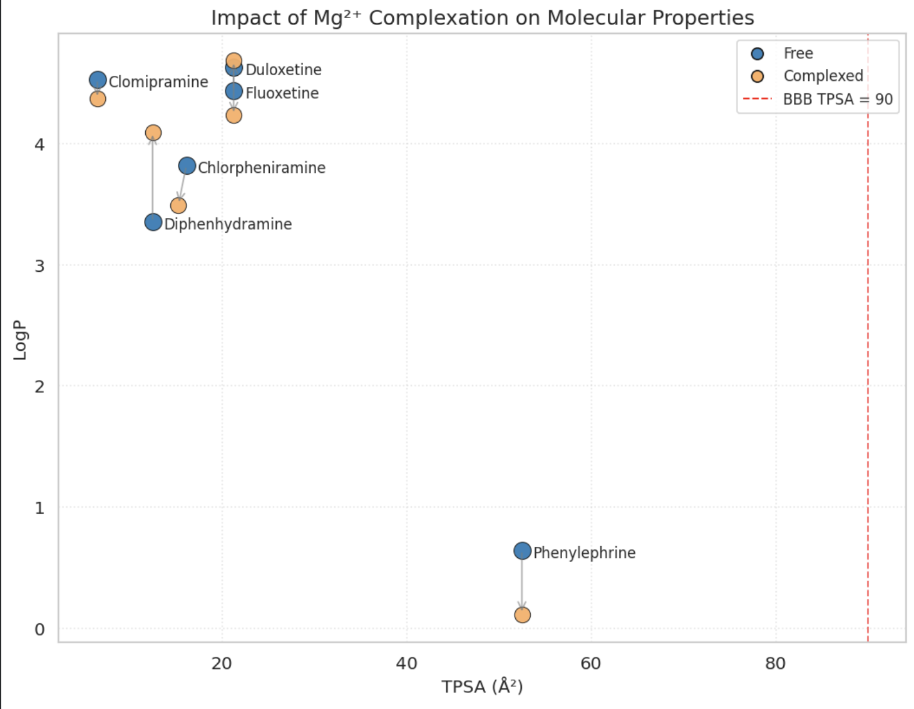
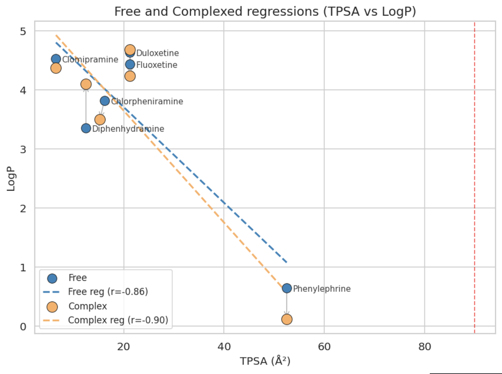
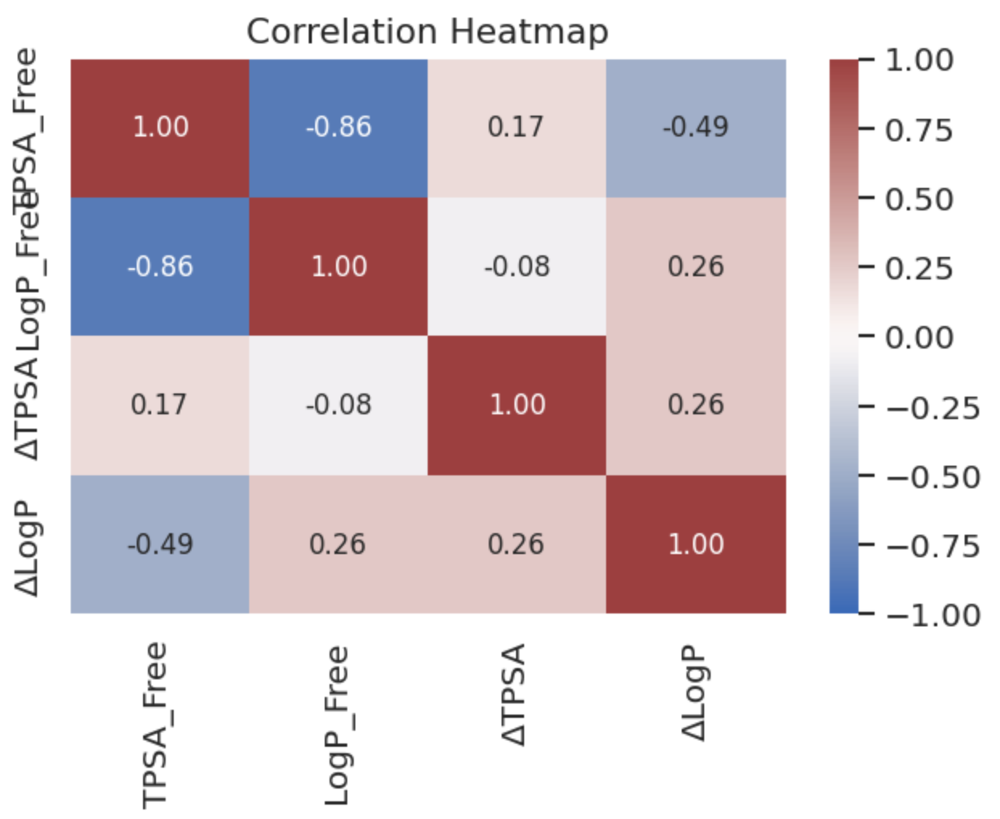
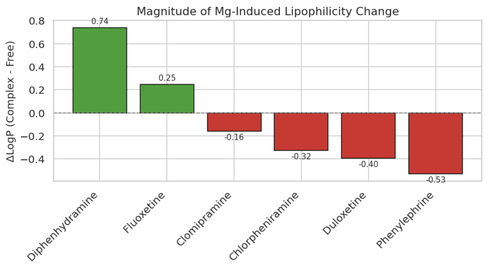
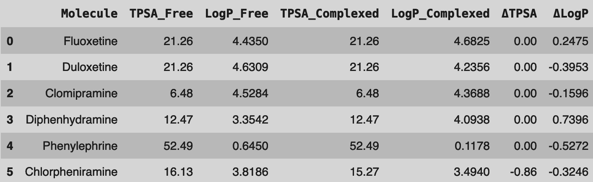
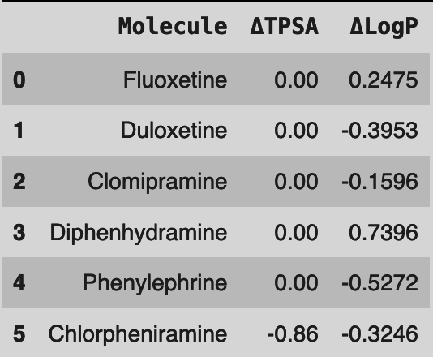

# Results (Computational)

> Part of our spring 2026 paper draft, copied as written. See the corrections in `../README.md`.

## Interpret Generated Graphs & Data Tables

### TPSA vs LogP





Molecules with lower TPSA, shown toward the left on the graph, are less polar and more likely to cross the BBB. In contrast, molecules with higher TPSA, shown toward the right on the graph, are more polar and tend to stay outside the brain. The red dotted line marks an upper limit of around 90 Ų, above which molecules generally cannot penetrate the BBB.

Molecules toward the top of the graph (higher LogP) are more fat‑soluble, meaning they diffuse more easily through the BBB. On the other hand, molecules toward the bottom (lower LogP) are more water‑soluble and correspondingly, are less likely to penetrate the brain. If a molecule’s LogP increases upon complexation, it has likely enhanced membrane permeability; if it decreases, the complex becomes more water‑bound and less likely to cross.

From the graphing results, most molecules are well below the threshold both before and after complexation, meaning both the complex and non-complexed drugs are likely permeable. Because Phenylephrine and Chlorpheniramine are closer to the threshold, Mg likely shifts their LogP or TPSA a little, but doesn’t push them across. Based on this data, Mg effects are insignificant for TPSA, clearly there for LogP, but are nowhere near a deciding factor for BBB permeability.

### Correlation Heatmap

This was by far the simplest plot to code, requiring minimal lines of Python:

```python
corr_cols = ['TPSA_Free','LogP_Free','ΔTPSA','ΔLogP']
plt.figure(figsize = (5.5,4.5), dpi = 120)
sns.heatmap(df[corr_cols].corr(), annot = True, fmt = ".2f", cmap = "vlag", center = 0, vmin = -1, vmax = 1,
            annot_kws = {"size":10})
plt.title("Correlation Heatmap", fontsize = 13)
plt.tight_layout()
plt.show()
```



The correlation heatmap shown above summarizes the relationships between the molecular properties in free and complexed forms. From the plot, we can see a strong negative correlation between TPSA and LogP (r = −0.86), meaning that, as molecules become increasingly polar (higher TPSA), their lipophilicity decreases (lower LogP). This can be explained simply through a biological lens: molecules that interact more strongly with water and less with the brain’s lipid membranes will be less likely to cross the BBB.

In contrast, we see an extremely weak positive correlation between ΔTPSA and ΔLogP (r = 0.26), which represent the changes computed with magnesium complexation. This suggests that complexation does not significantly change polarity or lipophilicity in any of the compounds studied. The small positive correlations between ΔTPSA and ΔLogP indicate minor shifts, but are not enough to affect the overall BBB permeability.

To conclude, the strong TPSA–LogP relationship reinforces that polarity and lipophilicity are the determining factors for whether or not these molecules are able to diffuse into the brain.

### ΔLogP Ranking Bar Plot



This graph shows how each compound’s lipophilicity is affected by magnesium complexation (ΔLogP = Complex − Free). Positive ΔLogP values (shown as green bars) mean the molecule has become more lipophilic (fat-soluble), and therefore more likely to cross lipid membranes. Negative ΔLogP values (shown as red bars) represent molecules that have become increasingly hydrophilic (water-soluble) and are less likely to penetrate the BBB. All the changes in lipophilicity are small in magnitude (ΔLogP < ±1), demonstrating that magnesium complexation his not a decisive factor for BBB permeability.

### Data Tables





The contrast between molecules that became more lipophilic versus more hydrophilic (less lipophilic) suggests that the effects of magnesium complexation depend on the molecule's individual geometry. TPSA values are all virtually identical before and after magnesium complexation. This indicates that the complexation process has no significant effect on the molecule’s polarity. Since ΔLogP and ΔTPSA changes are minimal, magnesium complexation does not appear to affect BBB permeability, indicating that each molecule’s fundamental characteristics remain largely unchanged.
