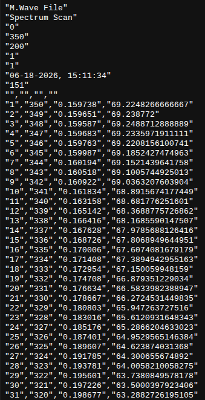
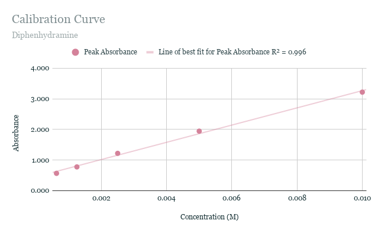
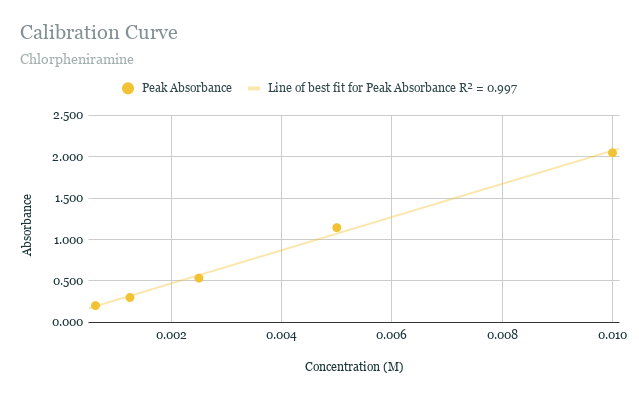
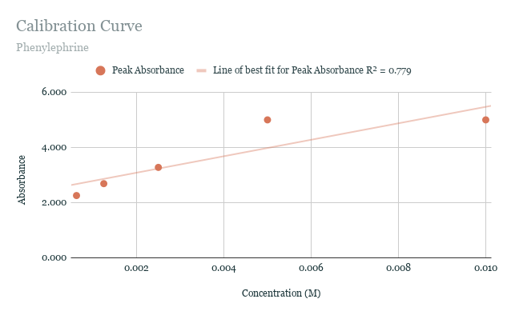
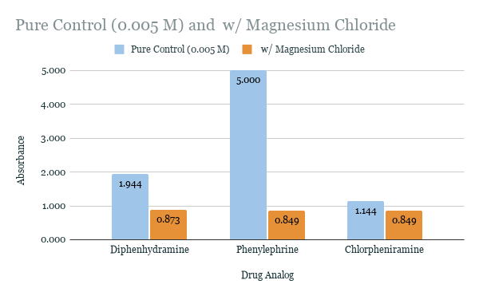

# Wet Lab (UV-Vis Spectroscopy)

> Part of our spring 2026 paper draft, copied as written. See the corrections in `../README.md`.

## Pre-Lab Preparation and Stock Calculations

Before starting the experiment, it was necessary to gather all the materials needed and plan out the lab. All of the analog medications were purchased from Walgreens Pharmacy, and are able to be obtained OTC, without a prescription. A Google Spreadsheet was used to collect all of the data from the lab, and was formatted prior to the completion of the experiment.

## Matrix Blank Isolation and Baseline Corrections

Because the commercial tablets were being used, we had to keep in account the fillers, dyes, and binders added to the medication during commercial processing. To do this, we first created "matrix blank" versions of each medication. To do this, we measured out for each substance what was the equivalent of 0.001 mol. For Diphenhydramine HCL, this was 0.2918 g. For Phenylephrine HCL, this was 0.2037 g. For Chlorpheniramine Maleate, this was 0.3909 g. Then, in a beaker, 20.0 mL of water was added to all of them, which was enough to fully saturate the solution and dissolve all of the medications (which are highly water soluble), while simultaneously not dissolving the majority of the other ingredients in the tablets. Filter paper was then placed in a funnel into another beaker, and the saturated solution was poured through, filtering out the medication and leaving only a "blank" sludge, which contained all the binders, dyes, and fillers. These fillers (the sludge) were then transferred into a separate beaker and mixed with 100.0 mL of deionized water. By creating the "blanks" we would then be able to measure the absorbance of these solutions and subtract that from the absorbance of the solutions with the active medication, in order to obtain results that solely measured the medications.

## Standard Concentration Calibration Curve

Before adding Magnesium to any of the medications, we collected the absorbance data for five different concentrations of each medication. The chosen concentrations to measure for the curve were 0.01 M, 0.005 M, 0.0025 M, 0.00125 M, and 0.000625 M. In the human body, normal magnesium levels fluctuate from around 0.00075 to 0.00095 M (0.75-0.95 mmol/L). Because of this, we took into account concentrations along that curve, noting that getting the specific accuracy of 0.00075 to 0.00095 M is difficult with school-grade chemistry equipment. To account for this, we measured with concentrations greater than normal blood levels to ensure we achieved accurate results. To do this, for each medication, we make a 100.0 mL 0.1 M stock solution by grinding with a mortar and pestle 0.001 mol of the medication. To calculate how much the equivalent of 0.001 mol was in mass, I did the following calculations.

```
For Diphenhydramine HCL (molar mass 291.82 g/mol):
Mass = 291.82 g/mol × 0.1 L × 0.01 mol/L = 0.2918 g Diphenhydramine HCL

For Phenylephrine HCL (molar mass 203.67 g/mol):
Mass = 203.67 g/mol × 0.1 L × 0.01 mol/L = 0.2037 g Phenylephrine HCL

For Chlorpheniramine Maleate (molar mass 390.86 g/mol):
Mass = 390.86 g/mol × 0.1 L × 0.01 mol/L = 0.3909 g Chlorpheniramine Maleate
```

Next, I measured and weighed out each medication to the amount calculated before adding 100.0 mL of water to create each solution. Then I went about measuring the differing concentrations into a cuvette (originally plastic). In each cuvette, I put about 4.0 mL of liquid in total, varying the amount of stock solution and water to differ concentrations. In the end, I had 15 samples in total for each standard calibration curve

## Sample w/ Addition of Magnesium

To achieve the central question asked in this experiment, there was one sample that would then have magnesium chloride added to it in order to see if there were any changes in absorbance intensity or in the wavelength at which the intensity peaked. The 0.005 M sample was used as the "pure control," so the sample with magnesium had the same amount of 2.0 mL of 0.01 M stock solution of the medication. The magnesium chloride used was in its hexahydrate form (MgCl₂·6H₂O), which has a molar mass of 203.30 g/mol. To obtain a 0.01 M stock solution for the magnesium, we repeated the same process done before.

```
For MgCl₂·6H₂O (molar mass 203.30 g/mol):
Mass = 203.30 g/mol × 0.1 L × 0.01 mol/L = 0.2033 g MgCl₂·6H₂O
```

So, for the samples with magnesium, 2.0 mL of each medication's 0.01 M stock solution was followed by 2.0 mL of the magnesium stock solution. This works when compared with the 0.005 M "pure control" sample, which contains 2.0 mL of the medication's stock solution and 2.0 mL of deionized water.

## Obtaining the Data (UV-VI Spectrometer)

With all the samples now collected, it was time to measure them in a spectrometer to find their absorbance. However, the one available in the chemistry classroom was a colorimeter, and did not measure wavelengths small enough to capture the peak wavelengths of the samples for this experiment. Instead, I was able to use a UV-VI Spectrometer from the biotech classroom, which has a wavelength range of 190-1190 nm, much more than enough for what I needed. Also, the plastic cuvettes I originally collected all the samples in also do not do well with lower wavelengths (under 300), which pushed me to use quartz cuvettes for the most accurate results. On the computer in the biotech lab, the results showed as graphs, but for it to be possible to transfer the files, they were converted into text files that wrote the data out instead.

This is an example of what the text files looked like:



Only two of the text columns were important to me: the second and third. The second column told me the wavelength, and the third column told me the absorbance at that specific wavelength. Unlike the colorimeter, where you have to set the wavelength you want to collect, UV-VI spectrometers show you the data at all wavelengths, letting you see where the absorbance peaks for each medication and whether or not it changes when magnesium is added.

## Graphs and Calibration Curves

By going through the files from the UV-VI spectrometer, I now had the raw data to create standard calibration curves for each medication as well as compare the changes that occurred when magnesium was added.









As it can probably be observed, for Diphenhydramine and Chlorpheniramine, the curves were almost perfectly linear. For Phenylephrine, the reason for it not being very linear is that the machine used to measure the absorbance maxes out at 5.000. Since absorbance is exponential and is equal to A = −log₁₀T, an absorbance of 5.000 means that 99.999% of the light was not able to get through to the detector. The reason Phenylephrine maxed out the absorbance but not the other two medications is due to its extremely high molar absorptivity constant (ϵ), meaning it essentially absorbs all the light that tries to pass through the UV-VI spectrometer.

Something major was noted in all of the samples when magnesium chloride was added. The absorbance decreased massively for all of them, and the absorbance was around 0.850 for all of them. Only the wavelength of Diphenhydramine changed with the addition of magnesium.

## Interpretation and Discussion

Diphenhydramine changed its peak wavelength with the addition of magnesium, going from 258 nm to 250 nm. This is what is described as a hypsochromic shift (commonly referred to as a "blue" shift). A shift in the wavelength means that the energy needed for the molecule's electrons to jump states changed. Since Mg²⁺ is a highly charged divalent cation, it strongly reacts with the electrons on Diphenhydramine's nitrogen or oxygen atoms. This then forms a coordinated ion-pair complex, stabilizing the ground state of the electron orbital, requiring more energy. Despite not changing their wavelengths, both Chlorpheniramine and Phenylephrine experienced a massive drop in absorption with the addition of magnesium (which Diphenhydramine had shown as well). This is because, with the addition of MgCl₂ ions in high concentrations, they effectively "out-compete" the drugs for reactions with the surrounding water molecules, forcing the molecules to shield themselves or clump slightly, pushing their levels of concentration out of the active path of the UV light, which lowered absorption. Particularly with Phenylephrine, which without the magnesium, maxed out the absorption reading on the spectrometer (at 5.000). This indicates that magnesium has a strong masking effect on Phenylephrine, likely because Phenylephrine has an exposed hydroxyl (-OH) group on its benzene ring that easily pairs with metal ions, changing how it can absorb light.
